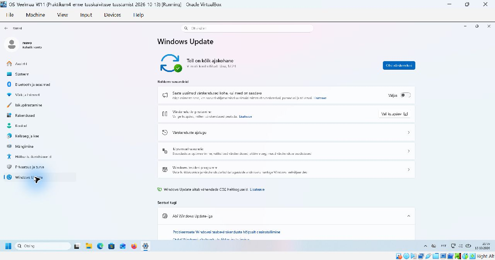
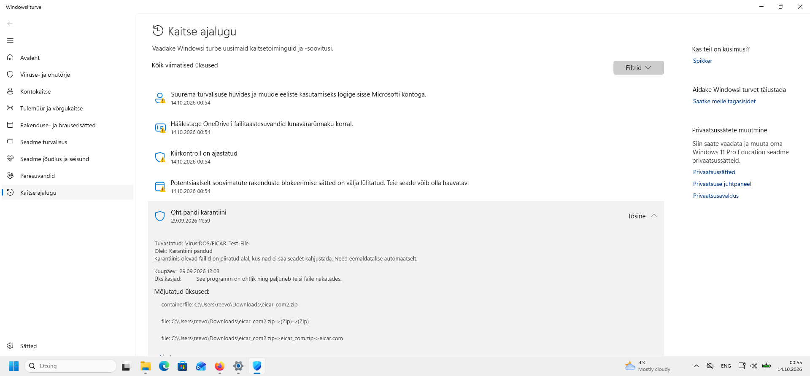
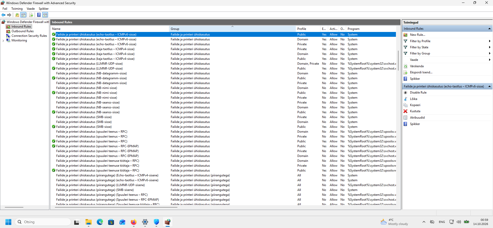
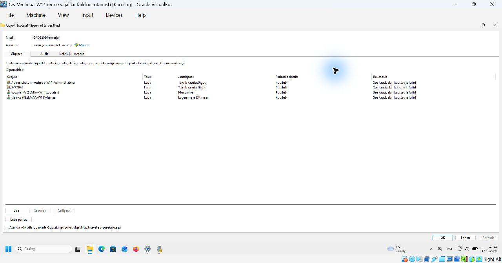
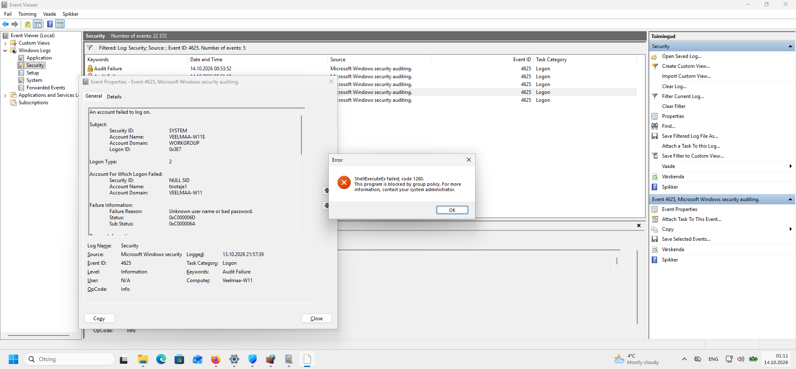
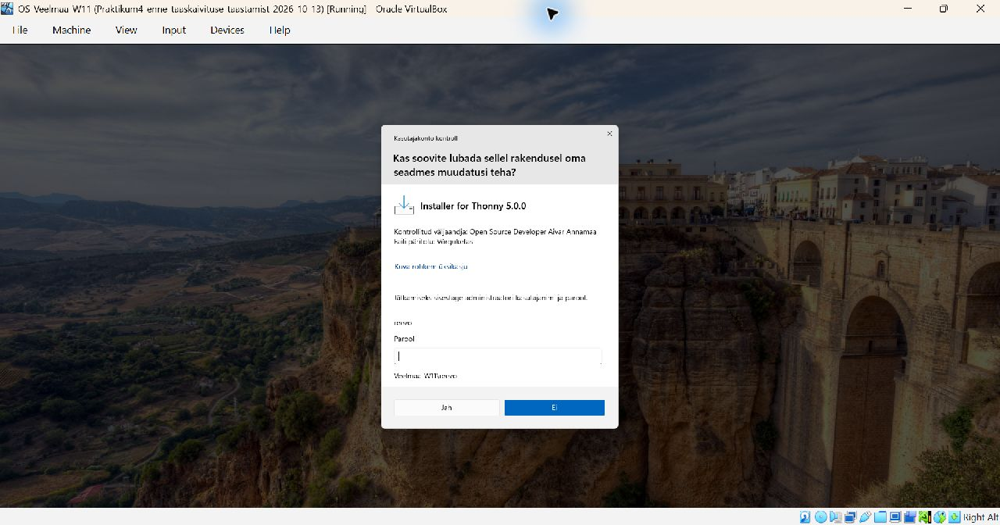
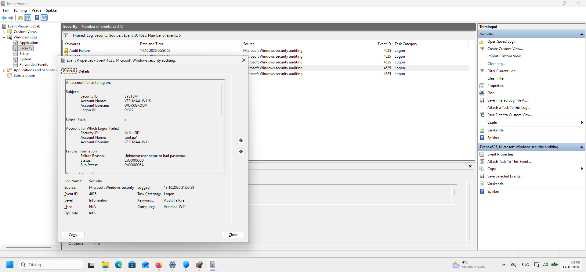
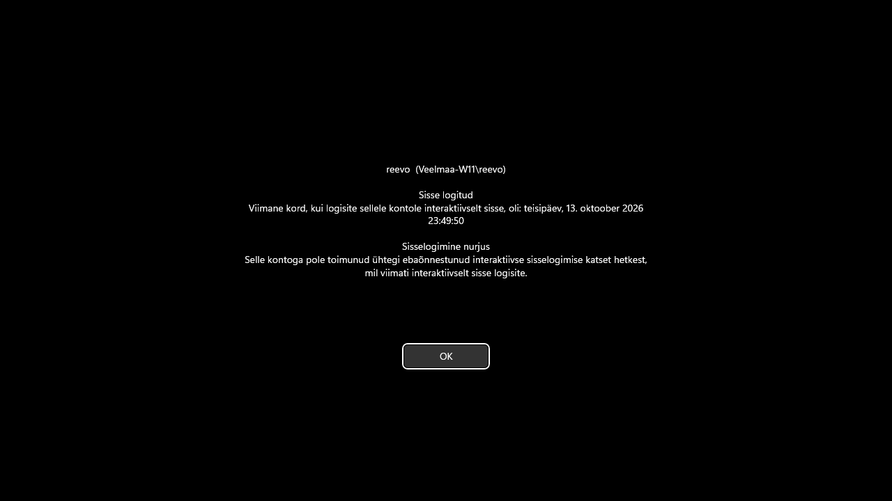

# Praktikum 4

Reevo Veelmaa – OS-Veelmaa-W11

## Ülesanne 4-1 – Windowsi uuendused

Windows Update näitab: „Teil on kõik ajakohane”.

## Ülesanne 4-2 – Viirusetõrje

Windows Defender tuvastas `Virus:DOS/EICAR_Test_File` testfaili arhiivis `C:\Users\reevo\Downloads\eicar_com2.zip` ja pani selle karantiini.

## Ülesanne 4-3 – Tulemüür

ICMPv4 ja ICMPv6 sissetulevad kajapäringud on lubatud (`Enabled: Yes`, `Action: Allow`).

## Ülesanne 4-4 – Administrator ja SYSTEM

Administrator saab hallata kasutajaid, paigaldada tarkvara ja muuta süsteemi seadeid. SYSTEM on Windowsi teenuste konto, millel on lisaprivileegid, näiteks `SeTcbPrivilege`.

Näiteks usaldatud sisselogimisprotsessi registreerimine funktsiooniga `LsaRegisterLogonProcess` vajab `SeTcbPrivilege`-õigust. Vaikeseadistuses on see SYSTEMil, kuid administraatoriõigustest üksi ei piisa.

Allikad: [Microsoft – LocalSystem](https://learn.microsoft.com/en-us/windows/win32/services/localsystem-account), [LsaRegisterLogonProcess](https://learn.microsoft.com/en-us/windows/win32/api/ntsecapi/nf-ntsecapi-lsaregisterlogonprocess).

## Ülesanne 4-5 – Kaustaõigused

Kaustal `C:\OS2026\tootaja1` on `tootaja1`-l muutmisõigus ja kaustal `C:\OS2026\tootaja2` on sama õigus `tootaja2`-l. `ylemus` saab mõlemas kaustas ainult lugeda ja käivitada. Teisele töötajale ligipääsu ei anta. Administraatoritele ja SYSTEMile jäi täielik juurdepääs. Õiguste pärimine on välja lülitatud.

## Ülesanne 4-6 – Turbesoovitus

Windowsi turve soovitab Microsofti kontoga sisse logida, et suurendada turvalisust ja kasutada konto lisavõimalusi. Soovitus on näha ülesande 4-2 kuvatõmmisel.

## Ülesanne 4-7 – Paigalduskeeld

`tootaja1` kontolt Thonny kõigile kasutajatele paigaldamisel ilmus viga 1260: programm on rühmapoliitikaga blokeeritud.

## Ülesanne 4-8 – Administraatori parooli küsimine

Lubasin tavakasutajal administraatori õigusi küsida. Thonny kõigile kasutajatele paigaldamisel küsiti `reevo` konto parooli. Pärast paigaldust oli käivitusfail olemas asukohas `C:\Program Files\Thonny\thonny.exe`. Programmi avanemist ei õnnestunud virtuaalmasina hangumise tõttu kontrollida.

## Ülesanne 4-9 – Ebaõnnestunud sisselogimine

Turbelogis on sündmus `4625`: kasutaja `tootaja1` sisselogimine arvutisse `Veelmaa-W11` ebaõnnestus 13.10.2026 kell 21:57:39. Põhjuseks oli vale parool (`Sub Status: 0xC000006A`).

## Ülesanne 4-10 – Viimase sisselogimise info

Registriväärtus `HKLM\SOFTWARE\Microsoft\Windows\CurrentVersion\Policies\System\DisplayLastLogonInfo` on `1`. Uuesti sisse logides kuvati eelmise sisselogimise kuupäev ja kellaaeg.

