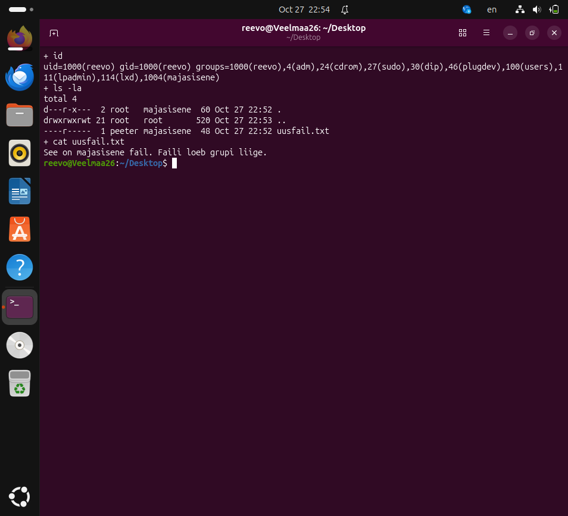
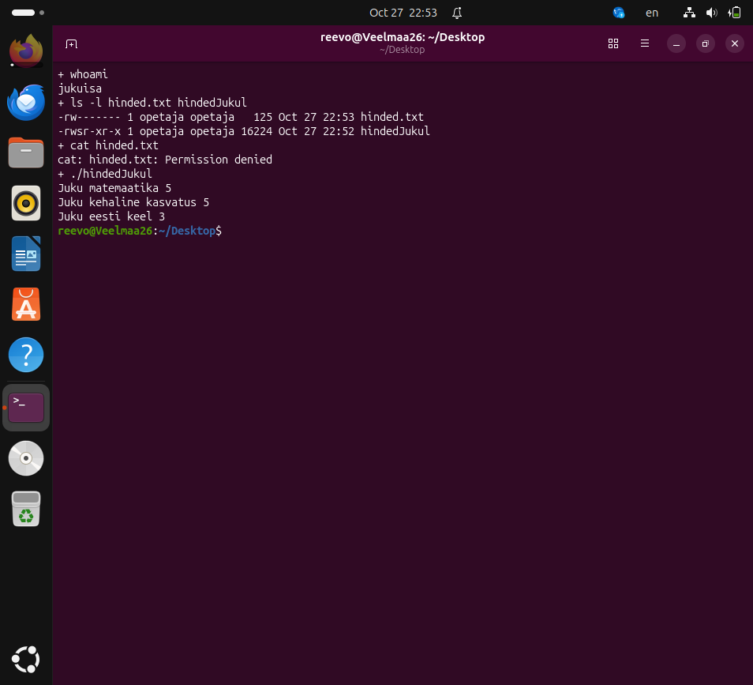

# Praktikum 6 – failiõigused Linuxis

Reevo Veelmaa

Katsed tehtud Ubuntu virtuaalmasinas 27.10.2026. [Katsete käsuväljundid](logid/).

## 6-1. Minimaalsed õigused

Lugemine: kataloogil `u=x` (100), failil `u=r` (400). Kataloogi läbimiseks piisab x-õigusest, kui failinimi on teada.

Kustutamine: kataloogil `u=wx` (300), failil võivad õigused puududa (000). Kustutamine muudab kataloogi kirjet, mitte faili sisu. Grupile ja teistele õigusi ei anta.

[Lugemise ja kustutamise katse](logid/6-1.txt).

## 6-2. Shelliskripti käivitamine

Ainult x-õigusest ei piisa: shell peab saama skripti sisu lugeda. Otse käivitamiseks on vaja r- ja x-õigust. Käsuga `sh skript.sh` piisab skriptil r-õigusest, sest käivitatakse interpretaator.

## 6-3. Privaatgrupp

Igal kasutajal on oma grupp, kuhu teised vaikimisi ei kuulu. Näiteks umask 0002 annab uuele tavalisele failile õigused 664, kuid grupi kirjutamisõigus ei anna teistele kasutajatele ligipääsu, kui nad sellesse gruppi ei kuulu. See lihtsustab ka teadlikult ühiste gruppidega töötamist. Privaatgrupp ei keela iseenesest teiste lugemisõigust.

## 6-4. Grupipõhine lugemine

Faili omanik on peeter ja grupp majasisene. Failil piisab grupi lugemisõigusest (040). Kataloogis faili poole pöördumiseks piisab grupi x-õigusest (010); `ls -la` jaoks on kataloogil lisaks vaja r-õigust (050). Katsetasin mõlemat: õigusega 010 töötas cat, kuid ls ebaõnnestus; õigusega 050 töötasid mõlemad. Faili õigused jäid 040.



[Lugemine kataloogi minimaalse x-õigusega](logid/6-4-minimaalne.txt).

## 6-5. setuid

setuid lubab käivitataval binaarprogrammil töötada faili omaniku efektiivse kasutaja-ID-ga. Nii saab jukuisa käivitatud programm lugeda õpetajale kuuluvat kaitstud faili ja väljastada ainult Juku read.



Pildil on matemaatikahinne juba ACL-katse käigus viieks muudetud.

## 6-6. setuid ja turvalisus

See võimaldab anda piiratud toimingu tegemise õiguse ilma kogu faili või administraatorikonto ligipääsu jagamata. Samas võib programmi viga anda käivitajale omaniku õigustes soovimatuid võimalusi. Eriti ohtlik on vigane root-omanikuga setuid-programm. Näidisprogramm pole üldotstarbeline turvaline hindesüsteem: see avab suhtelise failitee ja filtreerib lihtsalt sõne Juku järgi.

## 6-7. Sticky bit

Kataloogist /tmp/yhiskaust, mille omanik on opetaja ja õigused 1777, saavad peetri faile kustutada peeter (faili omanik), opetaja (kataloogi omanik) ja root. Teised tavakasutajad ei saa.

## 6-8. ACL

Laiendatud ACL-i tähistab `ls -l` õiguste lõpus plussmärk. ACL annab grupile direktor lugemis- ja kirjutamisõiguse. Näidatavad grupibitid vastavad laiendatud ACL-i korral maskile, mis piirab nimetatud kasutajate ja gruppide efektiivseid õigusi.

Peeter sai direktor-grupi liikmena muuta Juku matemaatikahinde viieks. `ls -la` näitas `-rw-rw----+`. `getfacl hinded.txt` väljund:

```text
# file: hinded.txt
# owner: opetaja
# group: opetaja
user::rw-
group::---
group:direktor:rw-
mask::rw-
other::---
```

Katse lõpus eemaldasin laiendatud ACL-i käsuga `setfacl -b hinded.txt`.

## 6-9. Immutable

Kui failil on +i atribuut, ei saa selle sisu muuta ega faili kustutada ka root. Vastava õigusega administraator peab atribuudi esmalt eemaldama:

```bash
sudo chattr -i testfail-2
rm testfail-2
```

Teine käsk eeldab kataloogis kustutamisõigust; vajaduse korral kasutatakse `sudo rm testfail-2`.

[Praktikumi juhend – Tartu Ülikool](https://courses.cs.ut.ee/2026/os/fall/Main/Praktikum6).

