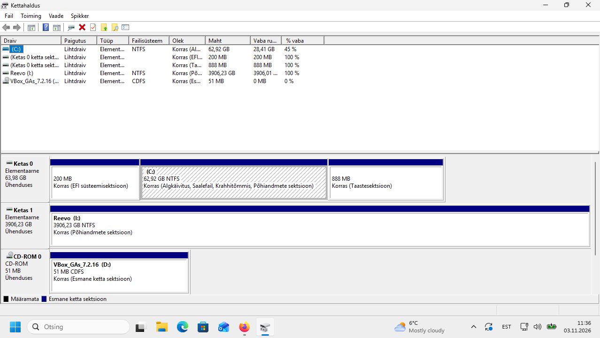
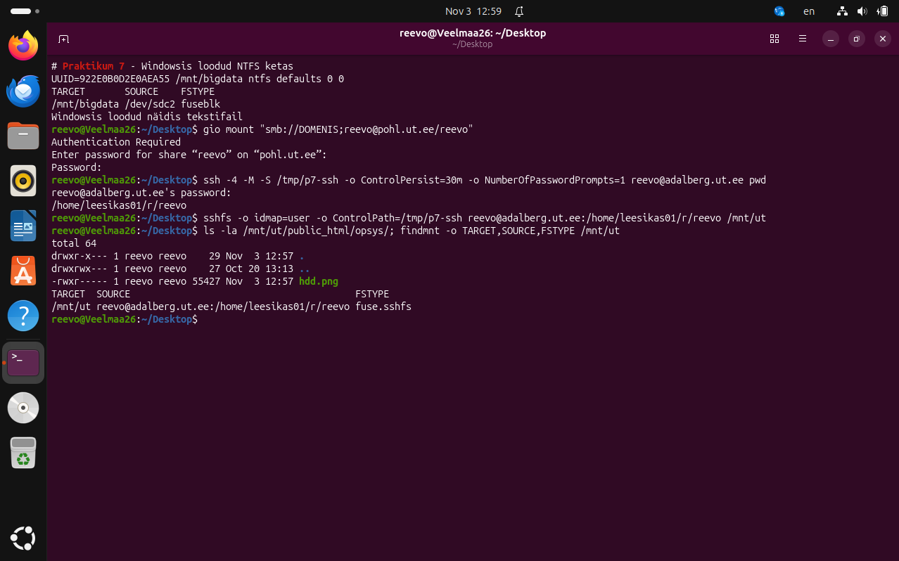
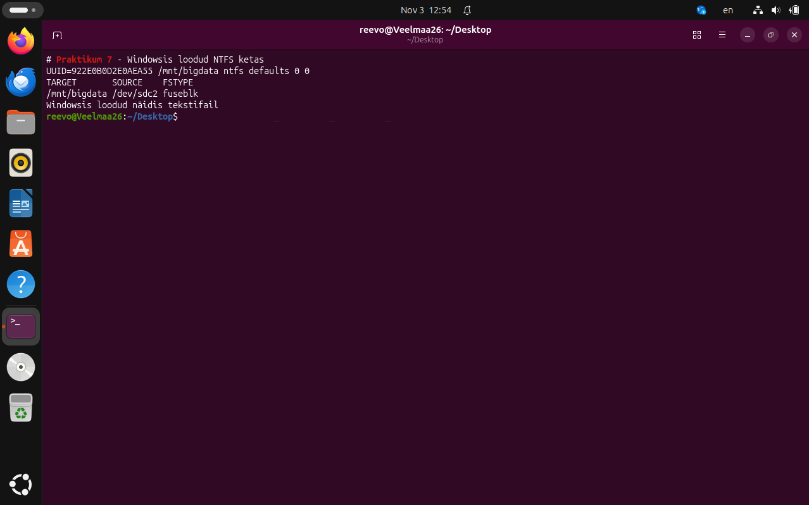

# Praktikum 7 – haakimine

Reevo Veelmaa

## 7-1. Ketta lähtestamine

Uuel tühjal kettal puudub partitsioonitabel, mille järgi operatsioonisüsteem tuvastaks partitsioonide asukohad ja suurused. Lähtestamine loob kettale GPT või MBR struktuuri ja ketta identifikaatori. Seejärel luuakse partitsioon ning vormindamisel NTFS-i failisüsteemi struktuurid failide ja vaba ruumi haldamiseks. Lähtestamine ja vormindamine on erinevad sammud; Windowsis määratud kettatäht annab failisüsteemile mugava ligipääsutee.

## 7-2. GPT eelised

- **Suurem kettamaht:** 64-bitised sektoriviidad ületavad MBR-i 32-bitise adresseerimise piiri. 512-baidiste loogiliste sektoritega on MBR-i piir ligikaudu 2 TiB, seega meie 4 TB ketas vajab kogu mahu kasutamiseks GPT-d.
- **Rohkem partitsioone:** Windows toetab GPT-kettal 128 partitsiooni; MBR-il on neli esmast kirjet ning rohkemate jaoks on vaja laiendatud partitsiooni ja loogilisi kettaid.
- **Varukoopia:** GPT päis ja partitsioonitabel on nii ketta alguses kui lõpus, mis aitab ühe koopia kahjustumise korral taastada partitsiooniteavet.
- **Veatuvastus:** päise ja partitsioonikirjete CRC32 kontrollsummad aitavad tuvastada metaandmete rikkeid. MBR-il samaväärseid kontrollsummasid pole.

Allikas: [Microsoft – Windows and GPT FAQ](https://learn.microsoft.com/en-us/windows-hardware/manufacture/desktop/windows-and-gpt-faq).

## 7-3. Windowsi võrguketas

4 TB ketas kasutab GPT partitsioonitabelit ja NTFS-i. Ketta nimi on Reevo ning Windowsis tähis I:. Failis `Veelmaa.txt` on tekst „Windowsis loodud näidis tekstifail“.



Pilt on TÜ kodukataloogis `public_html/opsys/hdd.png`: [ava hdd.png](https://kodu.ut.ee/~reevo/opsys/hdd.png).

## 7-4. SSHFS Ubuntus

Kodukataloog serveris on `/home/leesikas01/r/reevo`. Haakimise ja kontrolli käsud:

```bash
sshfs -o idmap=user -o ControlPath=/tmp/p7-ssh reevo@adalberg.ut.ee:/home/leesikas01/r/reevo /mnt/ut
ls -la /mnt/ut/public_html/opsys/
findmnt -o TARGET,SOURCE,FSTYPE /mnt/ut
```

`ControlPath` kasutas eelnevalt avatud SSH-ühendust. Fail `hdd.png` oli haagitud kaustas olemas.



Lahtihaakimine: `fusermount3 -u /mnt/ut`.

## 7-5. Mount parameetrid

`-o ro` haagib failisüsteemi kirjutuskaitstult (read-only). `-t auto` laseb mount'il failisüsteemi tüübi automaatselt tuvastada, selle asemel et seda käsitsi ette anda.

## 7-6. Tuvastatud failisüsteem

Füüsilist USB-mälupulka ei olnud ühendatud, seega USB-osa on teoreetiline. FAT32-pulga korral tuvastaks `-t auto` tüübiks `vfat`, NTFS-pulga korral NTFS-i. Tegelik tulemus sõltub pulga failisüsteemist ja kontrollitakse käsuga `findmnt /media/usb`.

## 7-7. Püsiv haakimine

Faili `/etc/fstab` lisatud rida:

```text
UUID=922E0B0D2E0AEA55 /mnt/bigdata ntfs defaults 0 0
```

Pärast taaskäivitamist oli ketas automaatselt haagitud kataloogi `/mnt/bigdata`. Windowsis loodud faili sisu oli loetav.



Allikad: [Praktikumi juhend](https://courses.cs.ut.ee/2026/os/fall/Main/Praktikum7), [Ubuntu mount käsiraamat](https://manpages.ubuntu.com/manpages/resolute/man8/mount.8.html).

